  

M.S. Computer Science student at NC State, based in Raleigh, NC. Building backend systems, full-stack products, and grounded AI tools. Seeking software engineering opportunities for May 2027 graduation.

### Toolbox

Java 21 / Spring Boot · TypeScript / React · Node.js / Express · PostgreSQL / Redis · BullMQ · Docker / GitHub Actions · JUnit / Playwright

### Selected work

- **[TaskFlow](https://github.com/SaiSumedh18/taskflow)** — Java 21 / Spring Boot team workspace. Per-request membership authorization, transactional updates, PostgreSQL row locks, and 31 integration tests. [Live demo](https://sai-taskflow-demo.onrender.com/).
- **[FinSight](https://github.com/SaiSumedh18/finsight)** — Finance platform with Redis caching and resilient BullMQ CSV imports. Local k6 benchmark: dashboard p95 18.9 → 3.1 ms with 10 users and 10,000 transactions. [Live demo](https://sai-finsight-demo.onrender.com/).
- **[InsightChat AI](https://github.com/SaiSumedh18/insightchat-ai)** — CSV analytics with code-computed statistics, selected evidence for OpenAI explanations, and SSE streaming. 36 backend tests and 2 Playwright E2E tests. Public demo runs without paid AI calls. [Live demo](https://sai-insightchat-demo.onrender.com/).

[GitHub](https://github.com/SaiSumedh18) · [Portfolio](https://saisumedhkaveti.work/) · [LinkedIn](https://www.linkedin.com/in/saisumedhkaveti/)

  

<!-- Edit profile.json, then run python scripts/build_profile.py. -->
